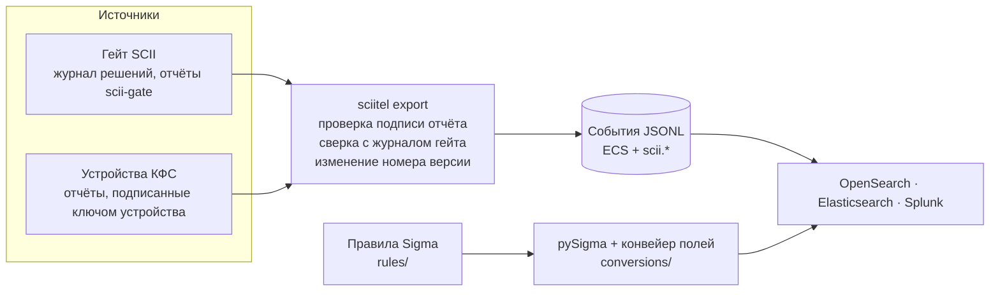
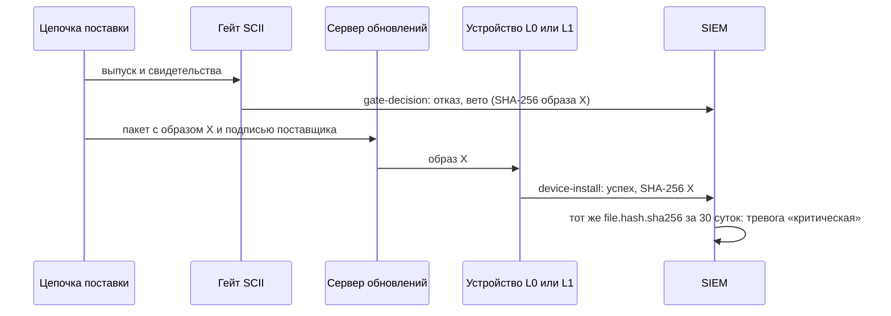
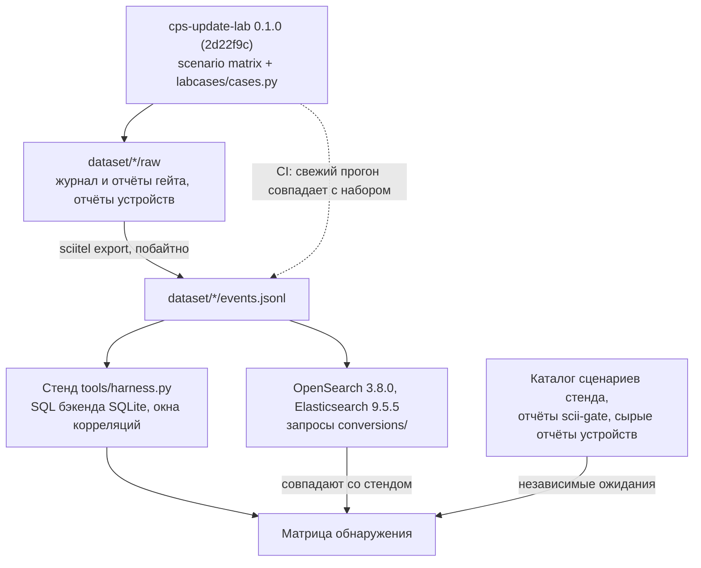

# scii-telemetry

[](https://github.com/alexqzm/scii-telemetry/actions/workflows/ci.yml)

Телеметрия гейта SCII и устройств киберфизических систем для SIEM: выгрузка решений гейта и
подписанных отчётов устройств в события ECS, правила Sigma и запросы для OpenSearch,
Elasticsearch и Splunk. Правила проверены на событиях учебного стенда
[cps-update-lab](https://github.com/alexqzm/cps-update-lab) — 33 прогонах его сценариев и 9
дополнительных случаях — и в живых OpenSearch и Elasticsearch.

Гейт [scii-gate](https://github.com/alexqzm/scii-gate) решает, допустить ли выпуск, по графу
доказательств цепочки сборки; устройство с [scii-agent](https://github.com/alexqzm/scii-verify)
проверяет квитанцию гейта перед установкой. Но в парке всегда есть устройства, которые
квитанций не проверяют, а у каждого отказа есть причина, которую надо расследовать. SIEM
сводит решения гейта и отчёты устройств вместе: видит установку образа, который гейт отверг,
откат на старую версию, подделанный отчёт, команды по каналу управления, который SCII не
защищает.



## События

Решение гейта — событие `gate-decision` с кодом решения, вето, полнотой и границами индекса
целостности, плюс 17 событий `gate-evidence` — по свидетельству профиля с его состоянием.
Отчёт устройства — событие `device-factory`, `device-install`, `device-reject` или `device-mgmt`
с кодом исхода (`BOOT_SIG`, `NO_RECEIPT`, `DIGEST`, `ROLLBACK`…), установленной версией и путём
(канал обновления или инженерная станция). Три признака выгрузка вычисляет сама:

| Поле | Что значит | Что ловит |
|---|---|---|
| `scii.report.signature` | подпись отчёта проверена ключом устройства | подделанный отчёт |
| `scii.reconcile.admitted` | установленный образ есть среди допусков журнала гейта для этого класса устройства | недопущенный образ на устройстве без проверки квитанций |
| `scii.device.svn_change` | номер версии вырос, не изменился или упал | откат на старый, когда-то допущенный выпуск |

Схема — [`docs/schema.md`](docs/schema.md) и [`schema/scii-event.schema.json`](schema/scii-event.schema.json);
шаблон индекса OpenSearch и Elasticsearch — [`schema/index-template.json`](schema/index-template.json).

## Правила

19 файлов: 12 правил по отчётам устройств, 5 по решениям гейта, 2 корреляции. Техники — по
MITRE ATT&CK 20.1, Enterprise и ICS.

<!-- rules:begin -->
| Правило | Источник | Уровень | ATT&CK | Что означает |
|---|---|---|---|---|
| [`scii_device_boot_signature_rejected`](rules/scii/device/scii_device_boot_signature_rejected.yml) | устройство | высокий | T0862, T1693.001 | загрузчик отверг образ, подпись поставщика над которым не проверяется |
| [`scii_device_image_digest_mismatch`](rules/scii/device/scii_device_image_digest_mismatch.yml) | устройство | высокий | T0862, T1693.001 | квитанция подлинная, но длина (SIZE) или дайджест (DIGEST) образа другие |
| [`scii_device_receipt_rejected`](rules/scii/device/scii_device_receipt_rejected.yml) | устройство | высокий | T0862, T1693.001 | квитанция не разбирается, подписана чужим ключом, изменена, выдана под другую политику или не о допуске |
| [`scii_device_update_without_receipt`](rules/scii/device/scii_device_update_without_receipt.yml) | устройство | высокий | T0862, T1195.002 | образ пришёл по каналу обновления без квитанции гейта (NO_RECEIPT) |
| [`scii_device_program_download_without_receipt`](rules/scii/device/scii_device_program_download_without_receipt.yml) | устройство | высокий | T0843, T0889 | программа с инженерной станции без квитанции гейта (NO_RECEIPT на пути ews) |
| [`scii_device_rollback_blocked`](rules/scii/device/scii_device_rollback_blocked.yml) | устройство | высокий | T1689, T1693.001 | номер версии в квитанции ниже установленного |
| [`scii_device_wrong_target`](rules/scii/device/scii_device_wrong_target.yml) | устройство | средний | T1693.001 | квитанция выдана для другого класса или экземпляра устройства |
| [`scii_device_state_invalid`](rules/scii/device/scii_device_state_invalid.yml) | устройство | высокий | T1693.001 | у устройства нет действительной копии состояния антиотката |
| [`scii_device_installed_image_not_admitted`](rules/scii/device/scii_device_installed_image_not_admitted.yml) | устройство | высокий | T0862, T1693.001 | установлен образ, которого нет среди допущенных гейтом для этого класса устройства (сверка с журналом гейта) |
| [`scii_device_version_decreased`](rules/scii/device/scii_device_version_decreased.yml) | устройство | высокий | T1689, T1693.001 | установлен образ с номером версии ниже прежнего |
| [`scii_device_report_signature_invalid`](rules/scii/device/scii_device_report_signature_invalid.yml) | устройство | высокий | T1692.002 | подпись отчёта устройства не проверяется его ключом |
| [`scii_device_management_command_accepted`](rules/scii/device/scii_device_management_command_accepted.yml) | устройство | средний | T0859, T0813 | контроллер выполнил команду stop или factory-reset по каналу управления |
| [`scii_gate_veto`](rules/scii/gate/scii_gate_veto.yml) | гейт | высокий | T0862, T1195.002 | опровергнуто свидетельство обязательной стадии |
| [`scii_gate_release_rejected`](rules/scii/gate/scii_gate_release_rejected.yml) | гейт | средний | T0862, T1195.002 | решение гейта «отказ» (вето или верхняя граница индекса ниже порога) |
| [`scii_gate_evidence_requested`](rules/scii/gate/scii_gate_evidence_requested.yml) | гейт | низкий | T0862 | не предъявлено обязательное свидетельство, гейт запрашивает его |
| [`scii_gate_rebuild_mismatch`](rules/scii/gate/scii_gate_rebuild_mismatch.yml) | гейт | высокий | T1195.002, T0862 | независимая пересборка из заявленного источника дала другой образ |
| [`scii_gate_source_signature_refuted`](rules/scii/gate/scii_gate_source_signature_refuted.yml) | гейт | высокий | T1195.002, T0862 | подписи коммитов или тега выпуска не проверяются доверенными ключами |
| [`scii_rejected_release_installed`](rules/scii/correlation/scii_rejected_release_installed.yml) | корреляция | критический | T0862, T1195.002 | устройство установило образ, по которому гейт ранее вынес отказ (тот же SHA-256, окно 30 суток) |
| [`scii_device_management_auth_failures`](rules/scii/correlation/scii_device_management_auth_failures.yml) | корреляция | средний | T1110 | три и более отказа DENIED в канале управления одного контроллера за 10 минут |
<!-- rules:end -->

## Матрица обнаружения

Сценарии cps-update-lab на трёх уровнях защиты устройства: L0 — без проверки, L1 — подпись
поставщика, L2 — квитанция гейта SCII. В ячейке — исход на устройстве и сработавшие правила.

<!-- matrix:begin -->
| Сценарий стенда | L0: без проверки | L1: подпись поставщика | L2: квитанция гейта SCII | Решение гейта по выпуску |
|---|---|---|---|---|
| N1 Штатное обновление 1.0.0 → 1.1.0 | принято → — | принято → — | принято → — | допуск → — |
| A1 Подмена образа на сервере обновлений | принято → установлен недопущенный образ; отвергнутый гейтом образ установлен | отказ BOOT_SIG → подпись образа (BOOT_SIG) | отказ DIGEST → образ не тот, что в квитанции | допуск → — |
| A2 Вредоносный образ, подписанный похищенными ключами поставщика | принято → установлен недопущенный образ; отвергнутый гейтом образ установлен | принято → установлен недопущенный образ; отвергнутый гейтом образ установлен | отказ NO_RECEIPT → обновление без квитанции | отказ, вето → вето гейта; отказ гейта; источник не подтверждён (s11, s14) |
| A3 Компрометация сборочной среды | принято → установлен недопущенный образ; отвергнутый гейтом образ установлен | принято → установлен недопущенный образ; отвергнутый гейтом образ установлен | отказ NO_RECEIPT → обновление без квитанции | отказ, вето → вето гейта; отказ гейта; пересборка не совпала (s24) |
| A3b Компрометация сборочной среды без контрольной пересборки | принято → установлен недопущенный образ; отвергнутый гейтом образ установлен | принято → установлен недопущенный образ; отвергнутый гейтом образ установлен | отказ NO_RECEIPT → обновление без квитанции | отказ → отказ гейта |
| A4 Откат на подлинную версию с уязвимостью | принято → версия понизилась | принято → версия понизилась | отказ ROLLBACK → откат остановлен (ROLLBACK) | допуск → — |
| A5 Подлинный выпуск для другого класса устройства | принято → установлен недопущенный образ | принято → установлен недопущенный образ | отказ TARGET → чужое устройство (TARGET) | допуск → — |
| A6 Загрузка логики с подложной инженерной станции | принято → установлен недопущенный образ; отвергнутый гейтом образ установлен | принято → установлен недопущенный образ; отвергнутый гейтом образ установлен | отказ NO_RECEIPT → загрузка логики без квитанции | не участвует |
| A7 Выпускной архив не совпадает с тегом | принято → установлен недопущенный образ; отвергнутый гейтом образ установлен | принято → установлен недопущенный образ; отвергнутый гейтом образ установлен | отказ NO_RECEIPT → обновление без квитанции | отказ, вето → вето гейта; отказ гейта; пересборка не совпала (s24) |
| M1 Граница метода: скрытая функция производителя | принято → — | принято → — | принято → — | допуск → — |
| M2 Граница метода: команда по каналу управления | команда factory-reset выполнена → команда управления | команда factory-reset выполнена → команда управления | команда factory-reset выполнена → команда управления | не участвует |
<!-- matrix:end -->

Что видно из матрицы:

- **Без проверки квитанций устройство ставит всё, а SIEM видит.** На L0 и L1 устройства ставят
  вредоносные образы (A2–A3b, A6, A7; подменённый образ A1 — только на L0, без проверки подписи)
  и чужой выпуск (A5); сверка с журналом гейта отмечает все 13 таких прогонов, а в 11 из них,
  где гейт этот же образ отверг, срабатывает и критическая корреляция.
- **Откат видит только номер версии.** Подлинный старый выпуск (A4) в журнале гейта допущен,
  монитор стенда молчит; правило изменения версии отмечает оба прогона на L0 и L1.
- **У каждого отказа на L2 есть правило**: подпись образа, образ не тот, что в квитанции,
  обновление и загрузка логики без квитанции, откат, чужое устройство.
- **Границы метода.** Штатное обновление (N1) и скрытая функция, которую выпустил сам
  поставщик (M1), не поднимают ни одного правила: SCII подтверждает происхождение, а не
  намерения. Команду по каналу управления (M2) SCII не останавливает, но SIEM её видит.

Дополнительные случаи [`labcases/cases.py`](labcases/cases.py) воспроизводят на том же стенде то,
чего нет в сценариях: пять видов поддельных и чужих квитанций (FORMAT, KEY, SIGNATURE,
DECISION, POLICY), образ короче квитанции (SIZE), подбор пароля управления, подделанный отчёт
устройства и выпуск без аттестации происхождения, по которому гейт запрашивает свидетельства.
Подделанный отчёт (C8) показывает, зачем выгрузка проверяет подпись: отчёт называет допущенный
образ вместо установленного вредоносного, и сверка с журналом гейта ничего не видит — тревогу
поднимает только недействительная подпись. Полная матрица, случаи и решения гейта —
[`docs/matrix.md`](docs/matrix.md).

Корреляция «гейт отверг — устройство установило»:



## Как проверено



- **Наборы воспроизводимы.** `dataset/` хранит сырые выходы стенда и выгруженные из них события
  (побайтно). CI заново прогоняет стенд на закреплённом коммите с закреплёнными scii-gate,
  scii-agent и cosign, повторяет случаи и сверяет свежие наборы с `dataset/` без изменчивых
  полей (время и пояснения с номерами ключей).
- **Ожидания независимы от правил.** Тесты строят ожидаемые срабатывания из каталога сценариев
  стенда (ожидаемые коды отказа и тревоги монитора), отчётов scii-gate (вето, опровергнутые
  свидетельства) и сырых отчётов устройств — и сверяют с ними матрицу.
- **Каждое значение условий что-то решает.** Мутационная проверка портит по одному 53 значения
  условий правил; каждая порча меняет срабатывания на наборах.
- **Правила корректны формально.** 31 валидатор pySigma с закреплённой ATT&CK 20.1 (Enterprise
  и ICS), поля и значения условий — по схеме событий, техники согласованы с тактиками.
- **Запросы работают в движках.** В OpenSearch 3.8.0 и Elasticsearch 9.5.5 запросы Lucene, EQL и
  ES|QL находят те же события, что стенд; найдены дефекты бэкенда EQL (логические и числовые
  поля, хвост `temporal_ordered`) с проверенными правками и разная семантика окон корреляций
  (EQL — скользящее окно, ES|QL и SPL — фиксированные корзины). Подробно — [`docs/siem.md`](docs/siem.md).

Единственное правило без реальной телеметрии — отказ `STATE` (нет состояния антиотката): стенд
передаёт состояние агенту аргументами и такого отказа не даёт, правило проверено на
синтетическом событии.

## Быстрый старт

```bash
python -m pip install --require-hashes -r requirements.txt   # Python 3.11+

# события из каталога стенда cps-update-lab после «cpslab --home DIR scenario matrix»
python -m sciitel export --lab-home DIR --profile <cps-update-lab>/cpslab/data/profile.json --out events.jsonl
python -m sciitel validate events.jsonl

# OpenSearch или Elasticsearch: шаблон индекса и загрузка
curl -X PUT localhost:9200/_index_template/scii-telemetry \
  -H 'Content-Type: application/json' --data-binary @schema/index-template.json
python -m sciitel bulk events.jsonl --index scii-lab > bulk.ndjson
curl -X POST 'localhost:9200/_bulk?refresh=true' -H 'Content-Type: application/x-ndjson' --data-binary @bulk.ndjson

# проверки репозитория
python -m pytest -q
python -m tools.matrix --check && python -m tools.convert --check
```

Запросы для движков — в [`conversions/`](conversions/), там же версии бэкендов и известные
расхождения. KUMA: бэкенда pySigma для неё нет, что нужно для переноса правил — в
[`docs/siem.md`](docs/siem.md#kuma).

## Состав

| Путь | Что там |
|---|---|
| [`sciitel/`](sciitel/) | выгрузка, проверка по схеме, сравнение наборов, шаблон индекса, тело `_bulk` |
| [`rules/scii/`](rules/scii/) | правила Sigma: `device/`, `gate/`, `correlation/` |
| [`pipelines/`](pipelines/) | конвейер полей pySigma: отбор `event.dataset` по источнику, индекс ES\|QL |
| [`conversions/`](conversions/) | запросы OpenSearch, Elasticsearch (Lucene, EQL, ES\|QL) и Splunk |
| [`dataset/`](dataset/) | наборы `cpslab-0.1.0` и `cases-0.1.0`: сырые выходы стенда, события, происхождение |
| [`labcases/`](labcases/) | дополнительные случаи C1–C9 на классах стенда |
| [`schema/`](schema/) | JSON Schema событий и шаблон индекса |
| [`tools/`](tools/) | стенд правил, матрица, проверки, конвертация, проверка в движках |
| [`tests/`](tests/) | тесты и синтетические события |
| [`docs/`](docs/) | схема, правила, матрица, работа с SIEM |

## Связанные репозитории

- [scii-gate](https://github.com/alexqzm/scii-gate) — гейт допуска обновлений по графу доказательств;
- [scii-verify](https://github.com/alexqzm/scii-verify) — проверка квитанции допуска на устройстве;
- [cps-update-lab](https://github.com/alexqzm/cps-update-lab) — учебный стенд, на котором проверены правила;
- [cicd-sigma-rules](https://github.com/alexqzm/cicd-sigma-rules) — правила Sigma для атак на конвейеры сборки;
- [cps-supply-chain-atlas](https://github.com/alexqzm/cps-supply-chain-atlas) — атлас атак на цепочки поставок КФС.

## Лицензия

Код — Apache-2.0 ([`LICENSE`](LICENSE)); правила Sigma в `rules/` — Detection Rule License 1.1
([`LICENSE.Detection.Rules.md`](LICENSE.Detection.Rules.md)). Как ссылаться — [`CITATION.cff`](CITATION.cff).
